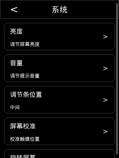
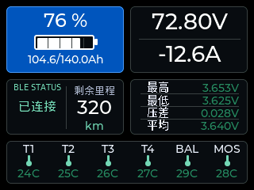
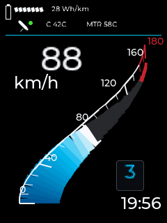
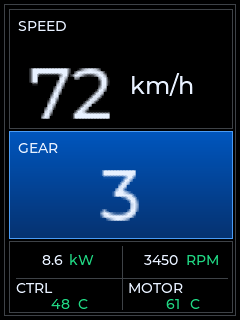
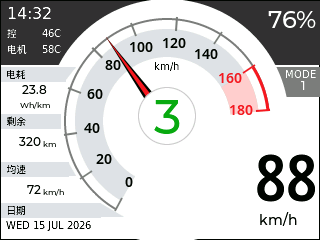

<h1 align="center">⚡ ESP32 BMS GPS 🛰️</h1>

<p align="center">
  <a href="./README.md">简体中文</a>
  ·
  <a href="./README.en.md">English</a>
</p>

ESP32 smart dashboard firmware for electric motorcycles, e-bikes, and light vehicles. It brings BMS, motor-controller, GPS, touchscreen, device hotspot, Web control, and phone casting into one system.

> The project is under active development and hardware validation. The core firmware and primary interaction paths are usable; OTA, track storage, and some hardware compatibility work are not complete.

## Acknowledgements and hardware files

Thanks to **luose**, the original author, for sharing the [original ESP32 BMS GPS project](https://oshwhub.com/luose/project_dffyscoz) on OSHWHub and providing a foundation for further development and hardware revisions.

The current schematic, PCB, EasyEDA project, Gerber files, and BOM are in the [hardware directory](./hardware/README.md). R5 is **2.2 Ω**. An exact **450 kΩ / 0805** purchasing part for R4 remains unconfirmed; R9 is not populated. See the [BOM notes](./hardware/2026-11-11-fpc-left18/BOM.md).

<h2 align="center">🖼️ UI Preview</h2>

<table align="center">
  <tr>
    <th>Device Settings Home</th>
    <th>Live BMS Data</th>
  </tr>
  <tr>
    <td align="center">
      <br>
      <sub>System settings, brightness, volume, slider position, and screen calibration</sub>
    </td>
    <td align="center">
      <br>
      <sub>76% SOC, 72.8 V, -12.6 A, remaining range, and cell voltages</sub>
    </td>
  </tr>
  <tr>
    <th>BMW S1000RR Dashboard</th>
    <th>Controller Data</th>
  </tr>
  <tr>
    <td align="center">
      <br>
      <sub>88 km/h, 24 Wh/km, gear 3, controller and motor temperatures</sub>
    </td>
    <td align="center">
      <br>
      <sub>86 km/h, gear 3, 3.8 kW, 4280 RPM, and temperatures</sub>
    </td>
  </tr>
  <tr>
    <th colspan="2">Honda Fireblade Dashboard</th>
  </tr>
  <tr>
    <td align="center" colspan="2">
      <br>
      <sub>88 km/h, 76% SOC, gear 3, power, temperatures, and range information</sub>
    </td>
  </tr>
</table>

## 🌐 Online Control Page

<p align="center">
  <strong>🌐 <a href="https://esp-bms-setting.vercel.app/">Open the Vercel Control Page</a></strong>
</p>

To control the device through its hotspot API:

1. Enable the device hotspot in TFT settings and view its QR code, SSID, and password.
2. Connect the phone or computer to that hotspot.
3. Open the control page, allow local-network access, and connect to `http://192.168.4.1`.

The control page is Chinese-first and can switch to English. The hotspot HTTP API is the primary working transport. A Web Bluetooth entry also exists, but it requires the matching firmware-side BLE control service. The `/cast` path launches the Android casting app.

## 🎯 Project Goals and Development Progress

| Goal | Development progress | Status |
| --- | --- | :---: |
| 🖥️ Provide glanceable speed, BMS, controller, and GPS dashboards on a TFT | Profiles select ST7789/XPT2046, ILI9488/FT6336U, or ST7796U/GT1151; LVGL dashboards, rotation, brightness, touch calibration, and the quick panel are integrated | 🚧 Being refined |
| 🔋 Connect to battery protection boards used across two-wheel vehicle platforms over BLE, with all telemetry coming from real devices | 8 BMS protocols are integrated: ANT (hardware-tested), JK, JBD, Daly, Yanyang, Bluebabe meter, Mingtang BMS, and Luxing EM02; the remaining models await hardware validation | 🚧 ANT tested; others pending |
| 🛞 Connect to controller platforms over BLE and accurately convert vehicle parameters | 16 controller models are integrated (FarDriver, BlueStone, Lingbo, Datai, Suniu, Yanxin, APT, Dunen, Zhike, JH, AUSI, Jiazhou, Xinda, Hobbywing, and more) with real telemetry, tire parameters, and gear-ratio conversion; the model is selected in settings and the rest await hardware validation | 🚧 Pending hardware validation |
| 🛰️ Provide GPS positioning, speed, time synchronization, track recording, and maps | 336H UART NMEA, RMC speed/fix/UTC, and profile-configured PPS diagnostics are integrated; track storage and maps are not complete | 🚧 Core path available |
| 📡 Support configuration, diagnostics, and maintenance through the Setup AP, embedded Web UI, and public HTTPS control page | Random hotspot credentials, QR code, `192.168.4.1`, configuration APIs, and BMS scan/bind entry points are integrated; the Vercel control page is live | ✅ Implemented |
| 🔊 Provide clear audio feedback for connection state and device actions | Classic ESP32 uses DAC and ESP32-S3 uses I2S; amplifier and audio pins come from the selected profile | ✅ Implemented |
| 📱 Extend maps, navigation, and complex views through low-latency Android casting | A standalone Kotlin app and casting protocol exist; latency, stability, and device compatibility are being refined | 🚧 In development |
| 🌏 Use Chinese by default and provide an English switch in device settings | The Chinese-first UI and settings-based language policy are defined; the TFT uses ASCII `ZH` / `EN` language markers | 🚧 In progress |
| 🔄 Complete the OTA, TF-card recording, track history, and map workflow | OTA does not yet provide a complete upgrade loop; TF-card recording, track history, and maps are planned for later phases | ⏳ Pending |

“Implemented” means the code path exists; it does not mean every target hardware combination has completed long-duration validation.

## 🔌 Supported Devices

Select the device model on the TFT: protection board under “BMS type”, controller under “Controller → Controller model”. The same options appear on the device page of the hotspot Web UI (`192.168.4.1`) and apply as soon as they are saved. “Auto detect” keeps the original FarDriver probe chain for configurations without an explicit model.

### Protection boards and battery meters (8)

| Brand / model | Status |
| --- | :---: |
| ANT | ✅ Hardware-tested |
| JK (JK04, JK02 24S, JK02 32S) | 🚧 Pending validation |
| JBD | 🚧 Pending validation |
| Daly | 🚧 Pending validation |
| Yanyang | 🚧 Pending validation |
| Bluebabe meter | 🚧 Pending validation |
| Mingtang BMS | 🚧 Pending validation |
| Luxing EM02 | 🚧 Pending validation |

Available data depends on the protocol: pack voltage, current, SOC, capacity, cell voltages (max/min/average/delta), temperatures, protection and warning state, balancing state, cycle capacity, and runtime. Bluebabe needs its six-digit matching code, entered on the Web UI device page.

### Controllers (16)

| Brand / model | Status |
| --- | :---: |
| FarDriver | 🚧 Pending validation |
| FarDriver YuanQu FOC | 🚧 Pending validation |
| BlueStone 300 | 🚧 Pending validation |
| Lingbo | 🚧 Pending validation |
| Datai | 🚧 Pending validation |
| Suniu | 🚧 Pending validation |
| Yanxin VITMC | 🚧 Pending validation |
| APT A8 | 🚧 Pending validation |
| APT Anpei (legacy) | 🚧 Pending validation |
| DN Dunen | 🚧 Pending validation |
| GEKOO Zhike | 🚧 Pending validation |
| JH | 🚧 Pending validation |
| AUSI | 🚧 Pending validation |
| Jiazhou DS11/DS15 | 🚧 Pending validation |
| Xinda | 🚧 Pending validation |
| Hobbywing SPD | 🚧 Pending validation |

Controllers report speed, RPM, gear, bus voltage/current, power, controller and motor temperature, throttle opening, and fault codes. Speed comes from one of three sources: reported directly by the controller (Datai); derived from tire-circumference and gear-ratio parameters the controller exposes (FarDriver, Suniu, Yanxin — Dunen uses a built-in default circumference); or computed from the tire size and gear ratio configured in settings for models that only report RPM.

> Controller frame layouts come from static analysis of Motexa 2.7.0 and have **not yet been validated with real-vehicle HCI captures**. On first connection, check for magnitude anomalies (voltage, current, or temperature off by 10× or 100×). Frame formats, field offsets, and confidence levels are recorded in the [protocol baseline](./docs/protocols/motexa-baseline.md), and per-frame differences against the existing implementations are in the [cross-verification report](./docs/protocols/cross-verification.md).

## 🛠️ Development Stack

| Layer | Technology |
| --- | --- |
| Firmware | C, ESP-IDF 6.0.2, FreeRTOS, CMake / `idf.py` |
| Display | LVGL 9.5, `esp_lvgl_adapter`, `esp_lcd`, ST7789/XPT2046, ILI9488/FT6336U, ST7796U/GT1151 |
| Device services | NimBLE, Wi-Fi SoftAP, `esp_http_server`, NVS, UART NMEA, ADC, LEDC, DAC, I2S |
| Embedded Web | Single-page HTML / CSS / vanilla JavaScript embedded in the firmware image |
| Vercel control page | React 19, TypeScript, Vite 6, Vercel |
| Android casting | Kotlin, Android SDK 35, Java 17, Gradle 8.14.2 |
| Quality and workflow | GitNexus, host protocol self-tests, ESP-IDF builds, and hardware logs |

Dependency versions, partitions, diagnostic images, and platform build commands are defined in the [project build contract](./docs/hardware-build-flash.md).

## 🚀 Configure, Build, and Flash

`start.sh` (Linux/macOS) and `start.cmd` (Windows) are the unified firmware configurator. Run `doctor` first; running without arguments starts guided configuration. `--dashboards` accepts `s1000rr`, `controller`, or `fireblade`, and `--modules` includes only the modules you need.

Linux/macOS:

```bash
# Check the shared ESP-IDF environment; use install-idf for a first ESP-IDF 6.0.2 setup
./start.sh doctor
./start.sh install-idf --dir /vol1/1000/toolchains/esp-idf-v6.0.2

# Guided configuration, or validate/save a Fireblade + BMS + controller profile
./start.sh
./start.sh validate --profile fireblade --modules bms,controller --dashboards fireblade
./start.sh configure --profile fireblade --modules bms,controller --dashboards fireblade

# Write the profile and build in an isolated directory; cloud builds only dispatch a workflow
./start.sh build-local --profile fireblade --modules bms,controller --dashboards fireblade
./start.sh build-cloud --profile fireblade --modules bms,controller --dashboards fireblade
```

On Windows, use the same arguments with `.\start.cmd`, for example `.\start.cmd doctor`, `.\start.cmd`, or `.\start.cmd build-local --profile fireblade --modules bms,controller --dashboards fireblade`. For a first setup, run `.\start.cmd install-idf --dir C:\esp\esp-idf-v6.0.2`. On this Linux host, the shared ESP-IDF is `/vol1/1000/toolchains/esp-idf-v6.0.2` and its tool cache is `/vol1/1000/toolchains/.espressif-v6.0.2`.

Linux local serial:

```bash
./scripts/esp-idf-env.sh -p /dev/ttyUSB0 flash monitor
```

Windows local serial:

```powershell
.\scripts\flash.ps1 -Port COM3 -Monitor
```

Interactive flashing defaults to a local serial port; remote RFC2217 requires an explicit selection and URL.

Erase Flash once when switching from a different partition table. See the [firmware hardware, build, and flash contract](./docs/hardware-build-flash.md) for build-only commands, erase flow, diagnostic images, partition layout, and troubleshooting.

## Desktop Simulator

On Debian, install `cmake`, `pkg-config`, a C compiler, and `libsdl2-dev`, then run:

```bash
./scripts/run-lvgl-simulator.sh --headless
./scripts/run-lvgl-simulator.sh --headless --portrait
./scripts/run-lvgl-simulator.sh
```

Windows runs natively without WSL. Download and extract an SDL2 development package, then pass its directory from PowerShell:

```powershell
.\scripts\run-lvgl-simulator.ps1 -SDL2Root C:\SDK\SDL2 --headless
.\scripts\run-lvgl-simulator.ps1 -SDL2Root C:\SDK\SDL2 --headless --portrait
.\scripts\run-lvgl-simulator.ps1 -SDL2Root C:\SDK\SDL2
```

Alternatively, set `SDL2_ROOT` in the current shell and omit `-SDL2Root`. The script only configures, builds, and launches the simulator; it does not install global dependencies or change system environment variables.

## 📁 Repository Layout

```text
main/                         Boot entry point and embedded Web UI
components/                   Runtime, display bridge, LVGL UI, protocol, and audio components
config/                       ESP-IDF sdkconfig templates and build configuration
firmware/                     Firmware profiles and partition tables
android-cast/                 Android low-latency casting app
vercel/                       Standalone Vercel control-page frontend
simulator/                    Host-runnable LVGL simulator
scripts/                      Build, flash, serial bridge, and diagnostic tools
tests/                        Host-runnable protocol and logic self-tests
docs/protocols/               Device protocol baseline, field maps, and cross-verification report
preview/                      Local UI preview scripts and ignored preview assets
img/                          README image assets
.github/                      GitHub Actions cloud-build workflow
```

`main/idf_main.c` owns boot orchestration only. Hardware, protocol, state, and UI logic belong in focused ESP-IDF components.
`build/`, `firmware-builds/`, and `output/` are local build or generated-output directories and are not part of the source layout.

## 📄 License

This project is available under the [PolyForm Noncommercial License 1.0.0](./LICENSE). You may use, modify, and distribute it only for noncommercial purposes. Commercial use requires separate written permission from the copyright holder.
